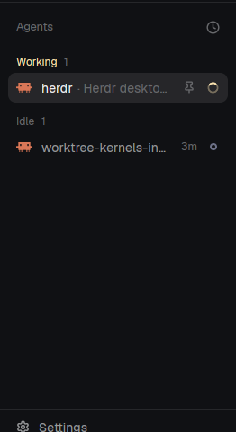

# Agents menu

Herdr's agents list with a right-click menu on every agent (Open, Pin, Rename tab, Close), like the spaces list has, herdr-mobile's **Monitoring** state for agents waiting on background work, and herdr-mobile's Alt keys: Alt+↑/↓ steps through agents, Alt+W closes, Alt+J/K scroll.

## What you see

- The sidebar's agents list: the same grouping, rows, status marks, pins and sort popup as Herdr's own `agents` mod (0.1.16), plus one state, **Monitoring**: the working spinner in sky blue (`#89dceb`, herdr-mobile's), turning slower (2400 ms), and in priority sort its own `Monitoring` section between Working and Idle.
- Right-click an agent row (expanded, collapsed rail, or a sub-agent row) and a 200px popup opens at the pointer, in `popover` with 12.8px text and 31px rows rounded 7px, `hover` on hover, a 14px `muted` icon from `mods/workspace-chrome/` before each label:
  - **Open** (`terminal.svg`)
  - **Pin to the top** / **Unpin** (`pin.svg` / `pin-off.svg`), agents only
  - **Rename tab** (`square-pen.svg`), agents only
  - a 1px `border` divider, then **Close** (`x.svg`)

## How it behaves

- **Monitoring** is an agent with work still going that its own status doesn't say: Claude Code's background shells, which herdr-core keeps as a `records` entry still `working` after the agent's turn ends (`done`, `idle` once you look), or an agent herdr-core calls `working` whose report message says something is `still running` (Claude Code's wording while it waits inside a turn). It ranks between working and idle, so a monitoring sub-agent doesn't make its parent look busy. Other agents don't report this and stay working or idle.
- **Open** focuses the agent's pane; for a sub-agent without a pane it peeks at it (`terminal.peek`).
- **Pin** toggles `terminal.pin`, as the row's pin button does.
- **Rename tab** runs `tab.rename` on the agent's tab; Herdr asks for the name.
- **Close** closes the agent's pane and ends its terminal (`pane.close`), with no confirmation; on a sub-agent it ends that terminal and its sub-agents (`terminal.kill`). Closing a tab's last pane can close the tab; closing the only agent pane left in a space puts a shell in its place first, so the space stays (as the herdr TUI did).
- Clicking an item closes the popup first, then runs it. Esc or a click outside closes it.
- The keys (`keys.json`), as in herdr-mobile:

  | Key | Command |
  | --- | --- |
  | Alt+B | `layout.toggle:sidebar` |
  | Alt+M | `app.settings {section: "machines"}` |
  | Alt+G | `mod.open:picker` (the sidebar's search) |
  | Alt+W | `agents-menu.close`: `pane.close`, keeping the space when it is its last agent pane |
  | Alt+T, Alt+N | `tab.new` |
  | Alt+↑ / Alt+↓ | `agent.prev` / `agent.next` |
  | Alt+K, Alt+PageUp / Alt+J, Alt+PageDown | `terminal.scroll {pages: -1 / 1}` (terminal section) |
  | Alt+Home / Alt+End | `terminal.scroll {to: "top" / "bottom"}` (terminal section) |

  Alt+←/→, Alt+Shift+←/→ and Alt+1–9 (tabs) are Herdr's defaults already.

## Built from

- **One mod**, `mods/agents-menu/`: a clone of Herdr's shipped `agents` mod (`mod.clone {name: "agents", as: "agents-menu"}`, version 0.1.16) with these changes:
  - `menu(address)` opens itself as a popup: `openOverlay({mod: "agents-menu", kind: "popup", width: 200, height: 160, props: {agentMenu: address}})`, the way the shipped mod opens its sort popup (`props: {sortMenu: true}`).
  - `init` returns early for `agentMenu` copies as for `sortMenu`; `render` draws `agentMenu(t)` for them.
  - `.on_mouse_down("right", () => this.menu(address))` on the expanded row, the collapsed row and the sub-agent row.
  - The sort popup's `openOverlay` names `agents-menu` (done by `mod.clone`).
  - Monitoring: `RANK.monitoring = 1.5`, `SECTION`/`SECTION_STATUS` entries for `1.5`, and in `render` the `agents()` list mapped to `status: "monitoring"` for addresses whose `terminals()` entry matches (`monitoring(k)`: a `done`/`idle` agent with a `records` entry still `working`, or a `working` one whose `report.msg` matches `/still running/i`); `kidStatus` does the same for sub-agents without a pane. `t` is `{ ...theme(), monitoring: "#89dceb" }`, so `t[status]` colors headers and fold counts; `status()` draws the spinner for it.
  - In `init`, one `cx.spawn` task loops on `nextCommand()` and handles `"close"` with `closePane()`.
- **The layout**: the `agents` block of the person's personal layout gets `content: {mod: "agents-menu"}` instead of `agents`. On one of Herdr's own layouts, clone it first (`layout.clone`).
- **`keys.json`**: the table above, merged into the person's keys.

## Watch out

- It's a copy of Herdr's `agents` mod: Herdr's later fixes to that mod don't reach it. Rebuild it from this recipe on a newer Herdr (clone again, reapply the changes).
- The Alt keys take these chords from terminal programs (Alt+B is no longer word-back in the shell; Ctrl+← still is). Alt+↑/↓ replace Herdr's default space switching (Ctrl+Shift+PageUp/PageDown still switch spaces); Alt+J/K in a terminal replace pane focus (Ctrl+Alt+arrows still focus). Ask before replacing keys the person already uses.
- Monitoring reads Claude Code's own reports: a background shell's `records` entry, or its "still running" wording while working. An agent that doesn't report its background work still shows as working or idle. Space and tab rings and the status bar come from other mods and still say working.
- Close has no undo and no confirmation.
- Linux-tested (herdr-app 0.1.16); on macOS, Option+letters type characters on many keyboards.

## Done when

- `herdr-app check mods/agents-menu` passes and `herdr-app status` shows no errors.
- The agents list looks and sorts as before; its sort popup still works.
- A Claude Code agent whose turn ended with a background shell still running (`hc get <t>` shows `done` with a `records` entry in state `working`) sits under Monitoring with a sky-blue spinner; it returns to Idle when the shell finishes.
- Right-clicking an agent opens the menu at the pointer; each item does what its label says, and the popup closes.
- Right-clicking a sub-agent offers Open and Close; Close ends only that sub-agent.
- Each key in the table does its command; Alt+J/K scroll only while a terminal has focus.
